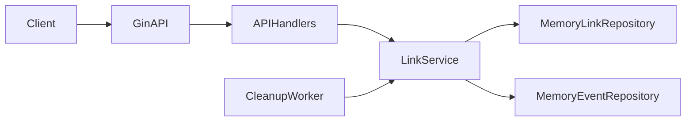
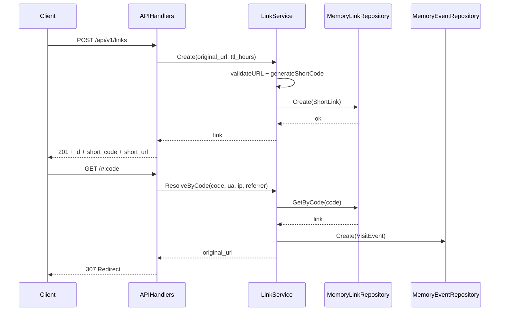

# URL Shortener Analytics Service

## Назначение

Сервис предоставляет управление короткими ссылками и сбор аналитики переходов через HTTP API.
Сервис закрывает полный цикл: создание ссылки, разрешение короткого кода, деактивация, чтение агрегированной статистики и последних событий.

## Ключевые возможности

- генерация короткого кода и выдача канонического `short_url`;
- TTL-ссылок с авто-деактивацией по фоновому cleanup-циклу;
- редирект по `GET /r/:code` с фиксацией события перехода;
- аналитика по ссылке: `total_clicks`, `last_click_at`, `top_user_agents`, `recent_events`;
- API-здоровье сервиса (`GET /health`) и сервисная JSON-подсказка (`GET /swagger`).

## Архитектурный обзор

- **API-слой** (`internal/api`): HTTP-маршрутизация, валидация входа, маппинг HTTP-кодов.
- **Сервисный слой** (`internal/service`): бизнес-правила, TTL, генерация short code, сбор аналитики.
- **Слой репозиториев** (`internal/repository`): абстракции `LinkRepository` и `EventRepository`, in-memory реализация с потокобезопасным доступом.
- **Background worker** (`internal/worker`): периодический вызов `CleanupExpired`.
- **Точка входа** (`cmd/app`): связывание зависимостей, настройка окружения, запуск сервера.





## Структура проекта

```text
cmd/app/main.go
internal/api/handlers.go
internal/service/link_service.go
internal/repository/repository.go
internal/repository/memory.go
internal/repository/sqlite_links.go
internal/repository/sqlite_events.go
internal/model/models.go
internal/worker/cleanup.go
run.bat
run.sh
```

## HTTP API

| Method | Path | Назначение |
|---|---|---|
| `GET` | `/health` | Проверка доступности сервиса |
| `GET` | `/swagger` | Базовая JSON-подсказка по API |
| `POST` | `/api/v1/links` | Создание короткой ссылки |
| `GET` | `/api/v1/links` | Список ссылок |
| `GET` | `/api/v1/links/:id` | Детали ссылки |
| `GET` | `/api/v1/links/:id/analytics` | Агрегированная аналитика по ссылке |
| `DELETE` | `/api/v1/links/:id` | Деактивация ссылки |
| `GET` | `/r/:code` | Редирект по короткому коду |

### Контракт создания ссылки

Request (`POST /api/v1/links`):

```json
{
  "original_url": "https://example.com/article",
  "ttl_hours": 24
}
```

Response (`201 Created`):

```json
{
  "id": "d2e05413-bcd9-463a-b589-c58b45d7a471",
  "original_url": "https://example.com/article",
  "short_code": "b146c06f",
  "short_url": "http://localhost:8080/r/b146c06f",
  "created_at": "2026-04-16T10:15:00.9018123Z",
  "expires_at": "2026-04-17T10:15:00.9018123Z"
}
```

## Сущности и связи

- `ShortLink`: `id`, `original_url`, `short_code`, `created_at`, `expires_at`, `is_active`.
- `VisitEvent`: `id`, `short_link_id`, `visited_at`, `user_agent`, `ip_address`, `referrer`.
- `LinkAnalytics`: модель представления для API (`total_clicks`, `last_click_at`, `top_user_agents`, `recent_events`).

Связь: `ShortLink (1) -> (N) VisitEvent` по `short_link_id`.

## Запуск

### Windows

- двойной клик по `run.bat`;
- или:

```powershell
cd "C:\Users\Мария\OneDrive\Desktop\pets\02-go-url-shortener"
& "C:\Program Files\Go\bin\go.exe" mod tidy
& "C:\Program Files\Go\bin\go.exe" run ./cmd/app
```

### Unix-like

```bash
bash run.sh
```

### Параметры окружения

- `PORT` (по умолчанию `8080`)
- `BASE_URL` (по умолчанию `http://localhost:8080`)
- `DB_PATH` используется в логе старта; фактическое хранение — in-memory репозиторий.

## Тестирование

```bash
go test ./...
```

Покрыты ключевые проверки сервиса: валидация URL, генерация short code, базовые правила создания ссылок.

## Smoke-check

```powershell
Invoke-RestMethod http://localhost:8080/health
Invoke-RestMethod http://localhost:8080/swagger

$body = @{ original_url = "https://example.com/article"; ttl_hours = 24 } | ConvertTo-Json
$link = Invoke-RestMethod -Method Post -Uri http://localhost:8080/api/v1/links -ContentType "application/json" -Body $body

Invoke-RestMethod http://localhost:8080/api/v1/links
Invoke-RestMethod http://localhost:8080/api/v1/links/$($link.id)
Invoke-RestMethod http://localhost:8080/api/v1/links/$($link.id)/analytics

Start-Process "http://localhost:8080/r/$($link.short_code)"
Invoke-RestMethod http://localhost:8080/api/v1/links/$($link.id)/analytics
```

## Инженерные решения и компромиссы

- in-memory репозитории выбраны как текущее хранилище: нулевые внешние зависимости, быстрый старт, детерминированное поведение сервиса;
- контракт хранения изолирован интерфейсами репозитория, поэтому API и сервисный слой не зависят от конкретной реализации;
- cleanup-процесс вынесен в отдельный worker, что отделяет управление жизненным циклом ссылок от HTTP-обработчиков;
- endpoint `/swagger` реализован как служебная JSON-подсказка, а не OpenAPI UI, что соответствует фактической реализации и исключает ложные ожидания.

## Практическая ценность для backend / ML-oriented engineering

- демонстрирует проектирование API-контракта и прозрачную декомпозицию по слоям;
- показывает эксплуатационный цикл событийной подсистемы: приём события, агрегирование, выдача аналитики;
- закрепляет практику предметной модели, валидации и управления состоянием сущностей (`active`/`expired`);
- формирует основу для последующего подключения потоковой аналитики и ML-признаков на базе накопленных `VisitEvent`.
